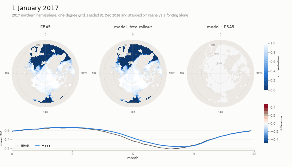
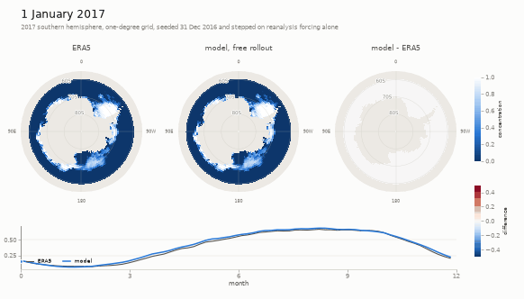
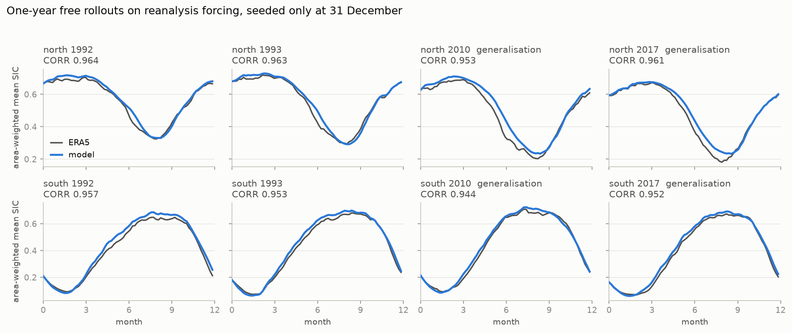

# Physics-Constrained Machine Learning for Sea-Ice Parameterisation

**A mixture-of-experts, distilled, and physics-constrained neural sea-ice closure for a GCM without full prognostic ocean states.**

This repository implements a sea-ice concentration (SIC) parameterisation in PyTorch and a two-file Julia interface for [SpeedyWeather.jl](https://github.com/SpeedyWeather/SpeedyWeather.jl). The deployed mid-SIC student contains **13,574 trainable parameters**. The central challenge is a physically underdetermined closure problem arising from the absence of essential ocean-state variables in the atmospheric GCM.





*Held-out 2017, 1° grid. Left: ERA5 reference; centre: predicted SIC; right: error. Starting from 31 December 2016, the predicted SIC is fed back for an entire year. Atmospheric forcing remains prescribed from ERA5: this is a **closed-loop offline SIC rollout**.*

## Results at a glance

| Held-out year | Arctic correlation | Antarctic correlation | Mean SIC bias (Arctic / Antarctic) |
|---|---:|---:|---:|
| 1992 | 0.964 | 0.957 | +0.013 / +0.024 |
| 1993 | 0.963 | 0.953 | +0.010 / +0.016 |
| 2010 | 0.953 | 0.944 | +0.029 / +0.010 |
| 2017 | 0.961 | 0.952 | +0.020 / +0.017 |

*Area-weighted hemispheric mean SIC bias. Training: 1980–1988; validation: 1989–1990; these four evaluation years are held out. Values come from the saved executed notebook (§13).*



The summer minimum remains challenging. These results demonstrate year-long feedback behaviour under observed atmospheric forcing.

## Why this is a difficult closure problem

Sea-ice evolution depends on ocean heat exchange, thermodynamics and transport, yet the target GCM does not expose the ocean variables required to determine the ice tendency uniquely. History, neighbouring-cell information and network capacity help, but cannot restore the missing state. Multiple learned operators can fit the same reanalysis data and still disagree strongly under changed forcing or repeated coupling.

The modelling objective is to constrain the admissible responses of an underdetermined operator, alongside minimising one-step prediction error, to support physically credible extrapolation. This motivates regime-specific architectures, derivative penalties evaluated at real **and synthetic** states, self-distillation for missing inputs, and high-concentration equilibrium regularisation.

## Model architecture and distillation

Three SIC regimes are combined by smooth concentration-dependent gates rather than hard switches:

| Regime | Model | Role |
|---|---|---|
| Low SIC | `ChangeGateClassifier` | Sparse change/no-change behaviour near the ice edge |
| Mid SIC | `RelaxationMoEClassifier` | Seasonal tendency and relaxation in the marginal/interior pack |
| High SIC | `RelaxationMoEClassifier` | Near-saturated Arctic ice and equilibrium response |

Low and mid bands are trained on pooled hemispheric data; the high band is Arctic-only. Inputs include SIC and its history, SST (`tos`), shortwave and longwave radiative forcing, wind, near-surface air temperature (`tas`), dew point (`tdps`), seasonality, and local spatial gradient/curvature features. The exact feature contract is defined in `sic_pipeline_lib.py` and notebook §1–2.

A 128-wide mid-band teacher is trained with input masking/self-distillation, followed by teacher–student distillation into a compact deployable model. **The documented offline results use `MASK_DISTILL = True`.** Distillation improves tolerance to missing or biased thermodynamic inputs under the tested conditions.

## Physics-constrained loss design

The objective combines weighted SIC-tendency regression and change/sign classification with **soft constraints on derivatives of the learned operator**. These constraints are designed to restrict physically implausible response directions, including away from the observed data manifold.

### Radiative-response monotonicity

One-sided autograd penalties discourage an ice-growth tendency that increases with stronger relevant radiative forcing (`rsds`, `rld`). The derivatives are evaluated on observed samples **and on synthetically perturbed radiative inputs**. Synthetic perturbations probe local forcing directions that may be poorly covered by ERA5 and make the model less reliant on observational correlations alone.

### Coherent atmospheric warming

A directional-derivative penalty discourages the predicted ice-growth tendency from increasing when `tas` and `tdps` rise **together**. The direction uses the feature normalisation so that the derivative corresponds to coherent physical warming, not an arbitrary change in two normalised columns. Synthetic coherent warming perturbations are used to target poorly sampled thermodynamic states, particularly dense ice under atypically cold air. Constraining only `tas` independently can miss a compensating response through `tdps`.

### Geometry-aware spatial-curvature response

A selective, one-sided penalty discourages the learned tendency from **amplifying local SIC extrema** through its curvature feature. The gradient/curvature relation identifies the relevant extremum configurations; it is not blanket diffusion across every strong ice edge. Additional synthetic curvature states probe grid-scale structures rarely present in the training distribution but potentially generated by autoregressive evolution.

### High-SIC equilibrium-map contraction

The high-concentration relaxation model is penalised when its equilibrium-map derivative with respect to SIC exceeds the target contraction threshold. The derivative is evaluated at **synthetically sampled SIC concentrations** while retaining the sampled atmospheric forcing. If satisfied globally, the contraction condition would imply uniqueness of the equilibrium under the relevant mathematical assumptions. Notebook §11 reports measured violations of this condition.

### Optional response controls

The loss implementation also supports a wind-response penalty and response-gradient anchoring. These were developed to avoid imposing an unsupported pointwise wind sign or unintentionally flattening other forcing sensitivities when modifying one response channel. They are configurable experimental terms.

### Why synthetic points matter

The synthetic samples are more than generic data augmentation: they test **the direction of the operator's response** where observational supervision is weak. This helps restrict the effective null space of admissible closures. The executed notebook (§11) distinguishes desired inequalities from measured violation rates and input sensitivities.

## Geometric feature and deployment consistency

The latitude-weighted SIC curvature feature is constructed as follows:

```text
q = ((W - C) + (E - C))/2 + cos^2(lat) * ((N - C) + (S - C))/2
```

`curvature_laplacian`, `curvature_tanh_scale`, and `cross_ref_deg` define the fitted input representation and must remain consistent with the exported weights. The blend gates are likewise tied to the weight set. Notebook §2 checks training constants, cache metadata, exported metadata when present, and Julia defaults. The Julia code uses **fixed angular differences**, not spectral gradients; preserve this convention when changing grid resolution.

## Code and evaluation

- `SIC_v4_lapmtas_selfcontained_executed.ipynb`: saved training/evaluation outputs, figures and physical diagnostics (recommended for reading).
- `SIC_v4_lapmtas_selfcontained.ipynb`: editable pipeline with expensive stages disabled by default.
- `sic_pipeline_lib.py`: features, model classes, losses and datasets.
- `build_cache_v2.py`, `processthedata_updated.py`, `add_tdps_to_processed.py`: ERA5 processing and caches.
- `rollout_sweep_dev/`: additional offline rollout and forced-column experiments.
- `make_initial_sic.jl`: prepares the gridded SIC history for the online component.
- `SpeedyWeather.jl-main/SpeedyWeather/src/parameterizations/ml_seaice_v4.jl` and `ml_seaice_model_v4.jl`: the two Julia component files; **both are required**.
- `docs/`: figures and GIFs embedded above.

The repository includes source and saved diagnostics but not ERA5 raw files, training caches, exported weights or complete coupled simulation output. Reproducing a fresh training run requires obtaining ERA5 and enabling the relevant notebook stages.

## Getting the data

The notebook reads `processed/processed_YYYY.nc`: one file per year, `time x latitude x
longitude` = 365/366 x 181 x 360 on a 1° global grid, carrying
`rsds, rls, tos, siconc, tas, tdps, rld, lsm, sfcWind`.

To rebuild it, download the ERA5 daily-mean fields through the
[CDS API](https://cds.climate.copernicus.eu/how-to-api) at `grid: 1.0/1.0` into one folder
per variable, then run `processthedata_updated.py`. The folder-to-variable mapping it
expects is at the top of that file:

```
Downward_SW_rsds -> rsds      2m_tem_tas   -> tas      Downward_LW_rlds -> rld
Net_downard_LW_rls -> rls     10m_windu_uas -> uas      LSM -> lsm (static)
SST_tos -> tos                10m_windv_vas -> vas
SIC_siconc -> siconc          2m_dp_tdps   -> tdps
```

Two conventions that file handles and that are easy to get wrong by hand: the dew-point
source files are latitude-descending while everything else ascends (`standardize_dataset`
fixes latitude order for all variables, not just that one), and `rsds` and `rld` arrive as
hourly accumulations and need the x24 correction.

## Running it

Install `requirements.txt`, then work down the notebook in order. All computationally expensive stages are controlled by flags that default to `False`, so the editable notebook can be run from top to bottom without triggering training or cache generation.

The executed copy is intended for reading; the editable copy is intended for running.

1. **§1 Configuration** — paths, blending gates, and feature-column definitions.
2. **§2 Consistency check** — the four-way agreement described above.
3. **§3 `BUILD_CACHE = True`** — builds the training caches from `processed/`. This step may take several hours.
4. **§5-§8 `TRAIN_MID_TEACHER`, `TRAIN_MID`, `TRAIN_LOW`, `TRAIN_HIGH`** — the four
   networks. The mid band is two stages: a 128-wide self-distilled teacher, then the
   distillation down to the shipped width under the warming penalty.
5. **§9 `RUN_EXPORT = True`** — writes the plain-text weight package next to
   `ml_seaice_v4.jl`, including the `curvature.txt` that §2 reads back. Weights are stored
   as plain `.bin` arrays plus a manifest, so the Julia side needs no Python at run time.
6. **§10-§12** — the offline battery: the blended three-band prediction, the ice edge where
   the low band's change gate lives, per-band scores against the three constraints, and the
   invariants. These print tables.
7. **§13** — the test set: eight one-year **free rollouts**, four years in each hemisphere,
   each seeded only from 31 December of the previous year and then stepped forward on
   reanalysis forcing with its own output as the next input. Two years sit in the training
   distribution and two are decades later. About 50 seconds for all eight.
8. **§14** — the rollouts as figures: the area-weighted mean concentration through the year
   against ERA5, the field from above the pole at the summer minimum, where the error sits
   on the map, and the whole year as an mp4 (GIF if ffmpeg is missing). Ice is shown in white.
9. **§15** — the single-step diagnostics as figures, drawn from the arrays §10-§11 already
   built.

Everything from §13 on displays inline and is written to `report_figures/`.

**On a fresh clone, §2 marks six rows `--` and ends with `CONSISTENT so far`.** The caches
come from §3 and the exported packages from §9, so on a fresh clone they are not written
yet; that is the normal state and it is not a mismatch. What must be `ok` on a fresh clone
is the eleven gate and column rows that §2 compares against `ml_seaice_v4.jl`. A `BAD` row
means a real disagreement.

Run All on a fresh clone finishes with no errors: each stage that is switched off, and each
evaluation section that has no checkpoints to evaluate, prints what it needs and the
notebook carries on.

`MASK_DISTILL` in §1 is set to `True`. Its mid band masks over the teacher's column set
during distillation and matches the teacher under masking, which makes it far more robust to
a missing `tas` or `tdps` input (hide-tas 2.6850 -> 0.8761, hide-tdps 1.6925 -> 0.2764) at a
cost of 0.0106 single-step pooled correlation and 0.0045 on the southern test set. The `False` option refers to a different, previously tested weight family.

**This changes the exported directory names, so the Julia side has to be told.** A different
mid band is a different package, so with `MASK_DISTILL = True` §9 writes

```
ml_seaice_weights_v4_lapmtasmd_unified_low
ml_seaice_weights_v4_lapmtasmd_unified_mid
ml_seaice_weights_v4_lapmtasmd_north_high
```

while `ml_seaice_v4.jl`'s own defaults are the `..._lapmtas_...` directories of the adopted
model, which this repository does not ship weights for. Construct the component with the
three directories spelled out:

```julia
MLSeaIceV4(spectral_grid;
           weights_dir_lowsic  = joinpath(dir, "ml_seaice_weights_v4_lapmtasmd_unified_low"),
           weights_dir_mid     = joinpath(dir, "ml_seaice_weights_v4_lapmtasmd_unified_mid"),
           weights_dir_highsic = joinpath(dir, "ml_seaice_weights_v4_lapmtasmd_north_high"))
```

§2 prints exactly these three lines, marked `--`, for the same reason: the name is
deliberately not one of the file's defaults. With `MASK_DISTILL = False` the names match the
defaults and nothing has to be passed.


## The offline test battery

Beyond the notebook's own §10-§12, `rollout_sweep_dev/` holds the diagnostics the model was
judged on:

- `central_pack_rollout.py` — multi-month free rollout of the blended three-band model
- `test_set_eval.py` — the held-out test years, north and south
- `box_forced_cycle.py`, `box_emulation*.py` — a single-column forced seasonal cycle, which
  isolates the parameterisation from circulation feedbacks
- `rollout_lib.py`, `_eval_rows*.py` — the shared loading and scoring code

These scripts resolve the repository root from their own location (override with
`SIC_ROOT`) and write their output into `report_figures/`. `box_forced_cycle.py` picks its
weight set from the `WSET` environment variable; set `WSET=lapmtasmd` to run it against what
this notebook builds. The suffixes the shared modules load at import time come from
`SIC_BOX_SUFFIX_LOW` / `_HIGH` / `_MID`, which §10 sets for you; the defaults are the older
weight family and point at a cache this repository does not build.

The anti-bistability requirement is not tested by a script here: it is a training constraint in
the high band's training objective (the global contraction bound, §8), and §11 of the
notebook checks it on held-out data directly. A separate equilibrium sweep over an
Arctic forcing climatology was used during development; it is left out of this
repository because the climatology it consumed was not reproducible from anything
here, and the notebook reports the measured behaviour of the soft constraint.


## The online component

`ml_seaice_v4.jl` is a SpeedyWeather.jl sea-ice parameterisation; it `include`s
`ml_seaice_model_v4.jl`, which holds the weight loader, the feature normalisation and the
forward passes, so the two files are the component. It loads the three weight
packages from directories beside itself, forms the gradient and curvature columns from the
model's own grid, blends the three bands through the SIC gate, and applies the tendency.

Note that the gradient and curvature columns are formed with **fixed angular differencing**,
not spectrally: 2°-trained weights transfer to a 1° grid unchanged, so no spectral gradient
is needed, but the angular baseline has to be fixed rather than grid-relative.

### Running it in SpeedyWeather

The component consists of two source files. To use it you need a SpeedyWeather source
checkout whose API it matches (it was written against 0.21.1-dev), with the two files in
`SpeedyWeather/src/parameterizations/` and one line added to `SpeedyWeather/src/SpeedyWeather.jl`:

```julia
include("parameterizations/ml_seaice_v4.jl")     # it includes ml_seaice_model_v4.jl itself
```

`export MLSeaIceV4` is inside the component, so nothing else has to be registered.

Then build the initial sea-ice state. The ML update runs once every five days and the networks
take the three previous cycles' concentrations as inputs, so the initial condition is four
fields five days apart, on the model's own grid, in one file:

```
julia --project=/path/to/SpeedyWeather make_initial_sic.jl \
      --trunc 63 --start 1989-01-01 --processed processed --out /path/to/weights_dir
```

The initial-state file supplies the four SIC history fields required for a reanalysis-initialised run. If the file is absent, the component starts from the atmospheric model's initial concentration and fills the history slots from that state, producing a flat-history cold start in both hemispheres.

With the file and the exported weights:

```julia
spectral_grid = SpectralGrid(trunc=63, nlayers=8, Grid=FullGaussianGrid)
sea_ice = MLSeaIceV4(spectral_grid;
    weights_dir_lowsic  = joinpath(dir, "ml_seaice_weights_v4_lapmtasmd_unified_low"),
    weights_dir_mid     = joinpath(dir, "ml_seaice_weights_v4_lapmtasmd_unified_mid"),
    weights_dir_highsic = joinpath(dir, "ml_seaice_weights_v4_lapmtasmd_north_high"),
    initial_sic_path       = joinpath(dir, "initial_sic_t63_19890101.bin"),
    initial_sic_path_south = joinpath(dir, "initial_sic_t63_19890101.bin"))
model = PrimitiveWetModel(spectral_grid; sea_ice=sea_ice)
simulation = initialize!(model)
run!(simulation, period=Day(30))
```

One file serves both hemispheres: the blocks are global fields and the component masks each to
its own domain.

### GCM integration

The learned sea-ice parameterisation is integrated into SpeedyWeather.jl and supports T31, T63, and T127 configurations. The repository includes the Julia implementation, model-weight export pipeline, and instructions for running coupled simulations.

The current `MASK_DISTILL=True` configuration is evaluated through the offline experiments presented above. Additional year-long coupled results will be included when available.
